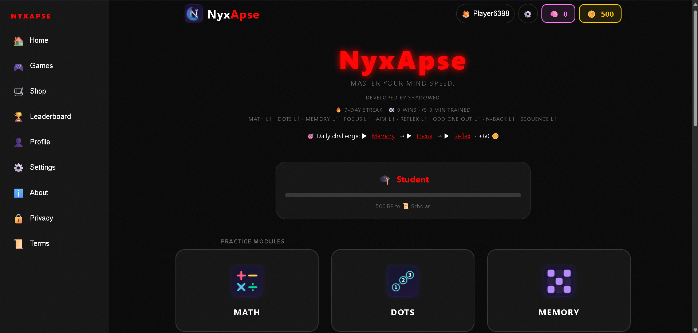
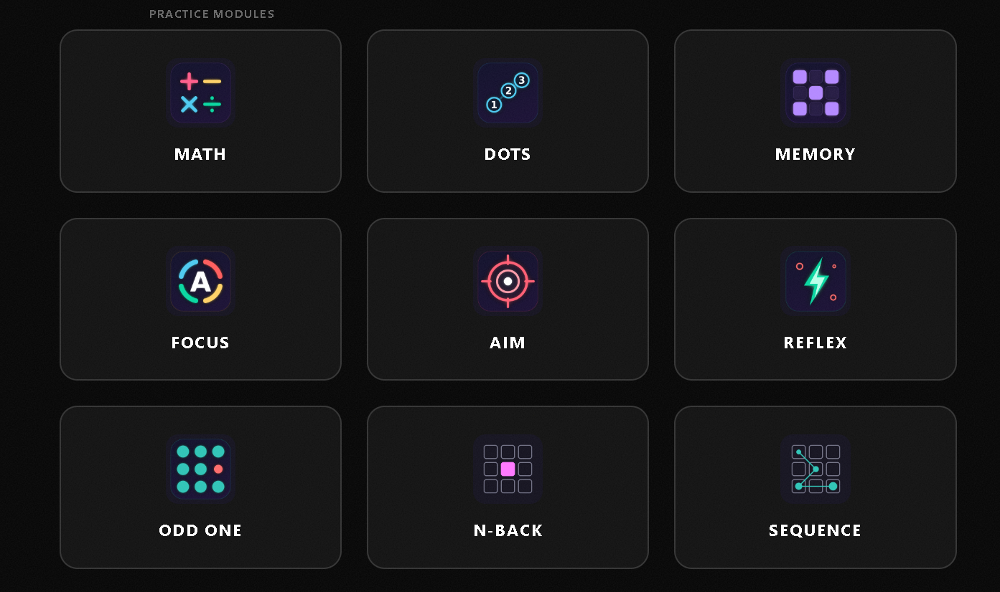
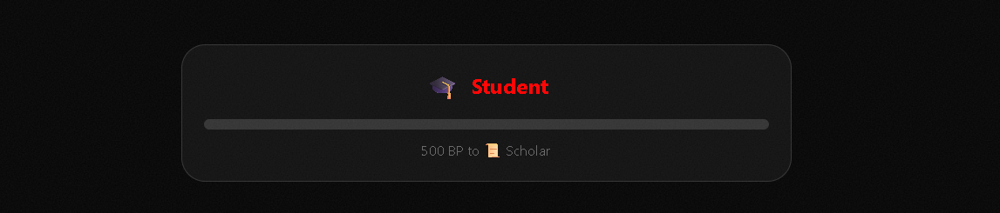

# 🧠 NyxApse

**NyxApse** is a web-based mental training suite designed to sharpen your cognitive reflexes, mathematical speed, focus, and memory. Build your **Brain Power**, climb the ranks, and master your mental discipline.

**[🚀 Play NyxApse Now](https://shadowed-monarch.github.io/NyxApse/)**


---

## 🎮 Game Modes
* **📝 Grammar:** Pick the word or phrase that fills the gap in the sentence. 10 right answers clear the level; each right answer adds 1 second and each wrong one costs 3. Harder grammar and more choices as you level up.
* **🔢 Math:** Solve falling equations before they hit the bottom.
* **⚪ Dots:** Tap numbered dots in order to train focus and visual coordination.
* **🧠 Memory Matrix:** Memorize glowing blocks, then recall them. The grid grows with your level.
* **🎯 Focus:** Type the *color* of the word, not the word itself. Trains attention and impulse control.
* **🔴 Aim:** Pop the bubbles falling two at a time before time runs out. The goal grows from 15 to 20 pops by level 100, and bubbles get faster each level. Bubbles are smaller on phones.
* **⚡ Reflex:** Dodge the falling bubbles and survive until the timer ends.
* **🔷 Odd One Out:** Tap the one shape that differs in color, size or rotation. The grid grows with your level.
- **🔲 N-Back:** A square lights up on a 3x3 grid. Tap SAME when it is where it was N steps ago. N grows from 1 to 5 as you level up and the pace gets faster. 3 mistakes fail the level. A classic working-memory trainer.
- **🔁 Sequence:** Watch the squares light up one after another, then tap the same squares in the same order. The sequence grows as you level up; one wrong tap fails the level.
  

## 🏆 Ranking System
Sixteen ranks, from Student to Nyxborn, with a rank-up celebration and "BP to next rank" on the home screen:
* 🎓 **Student:** 0 - 499 BP
* 📜 **Scholar:** 500 - 1,499 BP
* 🦉 **Sage:** 1,500 - 2,999 BP
* 💡 **Genius:** 3,000 - 5,999 BP
* ⚡ **Prodigy:** 6,000 - 9,999 BP
* 👑 **Mastermind:** 10,000 - 19,999 BP
* 🏆 **Grandmaster:** 20,000 - 49,999 BP
* 🌌 **Overlord:** 50,000+ BP
* 🗿 **Titan** 100,000 · ☄️ **Celestial** 200,000 · ♾️ **Eternal** 400,000 · 🐉 **Mythic** 800,000 · 🌠 **Transcendent** 1.5M · 🪐 **Cosmic** 3M · 💫 **Infinite** 6M · 🌑 **Nyxborn** 12M BP

## ✨ Features
* **Unlimited Levels:** Each game tracks its own level; speed and difficulty scale up.
* **Two Currencies:** Each win earns Brain Power (level × 5 up to level 30, then slower), which sets your rank and never goes down, plus coins (5 + level, up to 55) that you spend in the shop.
* **Skin Shop:** 32 accent skins bought with 🪙 coins: 20 solid colors (Blue 100 up to Gold 4,000), 5 animated skins (Aurora, Sunset, Ocean, Lava and the **Legendary Rainbow** at 10,000), and 7 you can only earn (Legend for level 100, Ember for a 30-day streak, and one for reaching each of Gold, Platinum, Diamond, Master and Legend on the leaderboard). Tap a skin to preview it before you buy. Buying skins never lowers your rank.
* **Light / Dark / Auto Mode:** Choose it in ⚙️ Settings; it applies to every game.
* **Daily Streak & Calendar:** Win a level each day to keep your streak. Your first win of the day pays bonus coins (streak days × 10, max 70), and a calendar on the home screen shows every day you played.
* **Stats:** Streak, total wins, time trained and level per game on the home screen.
* **Level Select:** Use ◀ ▶ in any game to replay lower levels.
* **Save Tools:** Export, import or reset your progress in ⚙️ Settings → Data. With Cloud save on, Export shows a short code and a **QR code**, and Import can **scan the QR** with the camera (or read a photo or screenshot of it) on the new device. A long offline save code is still there as a fallback.
* **Earnings Ledger (anti-cheat):** every win is written to a chained, signed log with the game, level, time and reward. Your Brain Power, coins and levels must match the log, and only a real finished round can add to them. Edits made in browser DevTools or the console are undone. It's a strong deterrent, not real security, since everything runs on the player's device.
* **Settings (⚙️ on every page, opens as a side panel):** focus sound (brown, pink or white, with volume), sound effects, vibration, theme (dark, light or auto), a **Minimal** style (flat, sleek and fast: no glow, shadows, grain, blur or color animation, and it keeps your colors), a separate **Black & white** switch, a **Colorblind-friendly** switch (safe colors plus a symbol for each color in Focus, ✓/✕ marks in Memory), and switches for glow, grain, confetti, large text and compact layout.
* **Profile & Menu:** pick a nickname and avatar on first launch, see your stats in your profile, and use the menu on the left of the home screen.
* **Leaderboard (optional):** weekly boards of Brain Power earned, powered by Supabase. Off by default; you join with a nickname and avatar, with no email or account. The server re-checks every win. See `supabase/README.md` to set it up.
* **Divisions and Seasons:** a ladder separate from your BP rank: Bronze 3 → 2 → 1, then Silver, Gold, Platinum, Diamond, Master and Legend (19 steps). You only see your own group (max 30, same division). Each week the **Ascent Zone** (▲) moves up, the **Drop Zone** (▼) moves down and everyone else is **Steady**; the zone sizes shrink as you climb. A season is a calendar month: at its end your final division is saved, coins are paid and everyone drops 2 steps. Your profile shows your best division with a small number for how many seasons you finished there (🥇²). Tap a name on the board to see that player's profile, and report cheaters.
* **Privacy:** no ads, no analytics, no tracking. See `privacy.html`.
* **Sound:** Adjustable-volume focus sound (brown, pink or white noise), plus win/lose sounds and vibration.
* **Math Variety:** Subtraction unlocks at level 4, multiplication at level 8.
* **Focus Buttons:** Tap color buttons instead of typing.
* **Daily Challenge:** A 🎯 button on the home screen. Two or three games a day; win one level in each for +60 coins.
* **Best Times:** Fastest clear is saved per game and level.
* **How-to-Play Popups:** Shown the first time you open a game (reopen with ?).
* **Pause Button:** Pause any running game with ⏸.
* **Confetti:** Celebrates every win and new skin.
* **Fair Timers:** Every game has a fixed timer (it cannot be changed), and it pauses when you switch tabs.
* **Installable:** Add to your home screen and play offline (PWA).
* **About Page:** Rules, ranks and tips, linked from the home screen.
* **Local Progress:** Ranks, levels and skins are saved in your browser's `LocalStorage`.
* **Responsive UI:** Works on desktop and mobile (mouse and touch).

## 🔊 Focus Sound
The focus sound (⚙️ Settings → Sound) is **brown noise** by default, and you can switch to pink or white. It keeps playing as you move between pages. Brown noise is a deep, soft rumble, a bit like distant rain or a waterfall. White noise is brighter and hissier, like static.

Which one is better comes down to taste. Research on background noise and focus is mixed, almost all of it used white noise, and no solid study shows brown noise beating white. Quieter is usually better than louder. Phone speakers play deep sounds weakly, so brown noise sounds thinner there, and headphones give the full effect. The sound is only a relaxing background, not a medical tool.

## 📁 Project Structure
```
NyxApse/
├── index.html, about.html, privacy.html
├── math.html, dots.html, memory.html,
│   grammar.html, stroop.html (Focus), aim.html, avoid.html (Reflex), oddout.html, nback.html, sequence.html
├── css/
│   ├── ui.css                      # shared responsive UI
│   ├── shell.css                   # settings, menu, shop, minimal look (loads last)
│   └── <page>.css                  # styles for each page
├── js/
│   ├── theme.js                    # skins, light/dark, saved looks
│   ├── game.js                     # ranks, streaks, ledger, save protection, messages
│   ├── shell.js                    # settings, profile, menu, focus sound, leaderboard screens
│   ├── config.js                   # your Supabase URL and public key (empty by default)
│   ├── leaderboard.js              # optional online leaderboard client
│   ├── qr.js                       # makes and reads the restore QR code (original code, no libraries)
│   └── <page>.js                   # logic for each page
├── supabase/                       # database script + setup guide for the leaderboard
├── .github/workflows/keepalive.yml # keeps a free Supabase project awake
├── android/                        # the Android app (APK / F-Droid)
├── fastlane/                       # store listing: description, icon, screenshots
├── fdroid/                         # the entry you submit to F-Droid
├── tools/set_version.py            # change the version everywhere at once
├── docs/RELEASE.md                 # step-by-step release guide
├── manifest.json, sw.js            # installable / offline support
├── LICENSE                         # MIT
└── logo.png, icon*.png, *.png      # images
```

## 🛠️ Technical Details
* **Frontend:** HTML5, CSS3, JavaScript (ES6+). No frameworks.
* **Data:** `LocalStorage` on your device. No account is needed. An online leaderboard (Supabase) is optional.
* **Shared Theme:** `theme.js` applies the saved mode and skin to every page.
* **Shared Logic:** `game.js` handles ranks, streaks, stats, sounds and save tools. `sw.js` + `manifest.json` make it installable.
* **Deployment:** Hosted via GitHub Pages.

> [!IMPORTANT]
> **Data Note:** Clearing your site data or browser history will reset your Brain Power, levels, and unlocked skins.

## 📱 Android app and F-Droid
The `android/` folder is a small native app that shows the bundled game. It asks for the camera only when you tap **Scan QR code** to restore progress; nothing is recorded or sent. See `docs/RELEASE.md` for how to build the APK, publish on F-Droid and change the version.

## 📄 License
MIT, see the `LICENSE` file.

## 👤 Author
Developed and owned by **Shadowed**.
* **GitHub:** [@shadowed-monarch](https://github.com/shadowed-monarch)

## Polish
* **Division badges:** each division family has its own SVG shield shape (so it also works without color) and dots for the step; Legend glows.
* **Animations:** smooth screen, card and popup transitions, and an animated demo in every game's how-to. All animations turn off in Minimal style and with your device's "reduce motion" setting.
* **Achievements:** 30 badges, each worth 25 coins, all behind one 🏅 button on the home screen.
* **Keyboard:** Space or P pauses any game. N-Back uses Enter or J for SAME.
* **Settings → Data → Clear app cache:** removes downloaded app files only. Your progress is kept.

## Newest additions
* **Daily challenge:** 2 or 3 different games a day (the same for everyone), played at your own level. After each one a popup counts down and opens the next game by itself (you can tap Stay).
* **Settings side panel:** Settings slides in from the right with tabs for Sound, Look, Effects, Online and Data. It fits a phone screen and closes with ✕, a tap outside or Esc.
* **30 drawn profile icons** (people, shadow, fire and game themes) next to the emoji avatars. They are original SVG drawings made by `tools/gen_avatars.py`.
* **Nickname filter:** one English word list (`tools/gen_namefilter.py`) generates both the app check and the server check. It catches tricks like `sh.t`, `f u c k`, `$h1t` and stretched letters, and it keeps an allowlist so innocent names (Scunthorpe, Peacock) pass. Edit the lists in the tool, run it, and re-run `supabase/schema.sql`. Regression test: `node tools/test_namefilter.js`.
* **Cloud save (optional, 16+):** automatic backup with a 10-digit code. After clearing data or on a new phone, open Settings → Data → Import and either scan the QR code or enter your nickname and the 10-digit code. Wrong guesses lock a nickname for an hour. A long offline save code still works as a manual backup (Export → Copy long offline code).
* **Leaderboard age:** 16 or older, or older where your country requires it.
