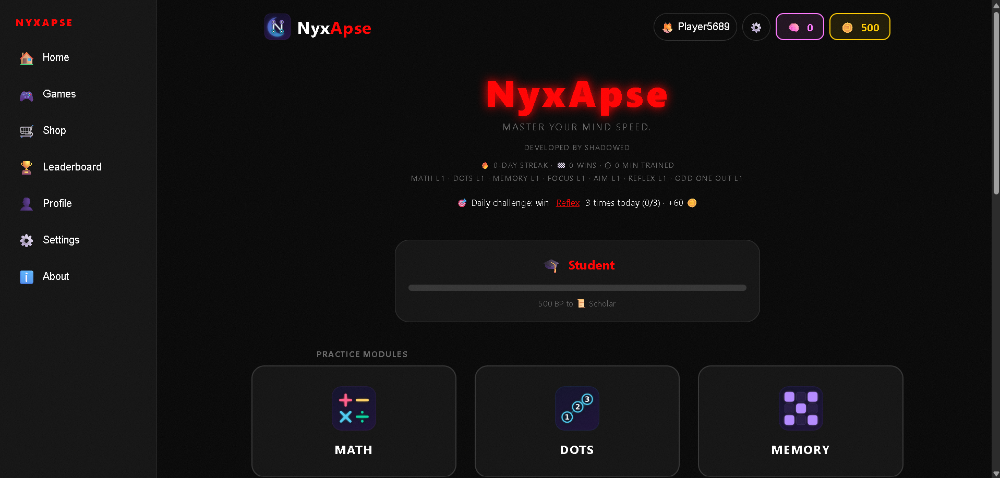
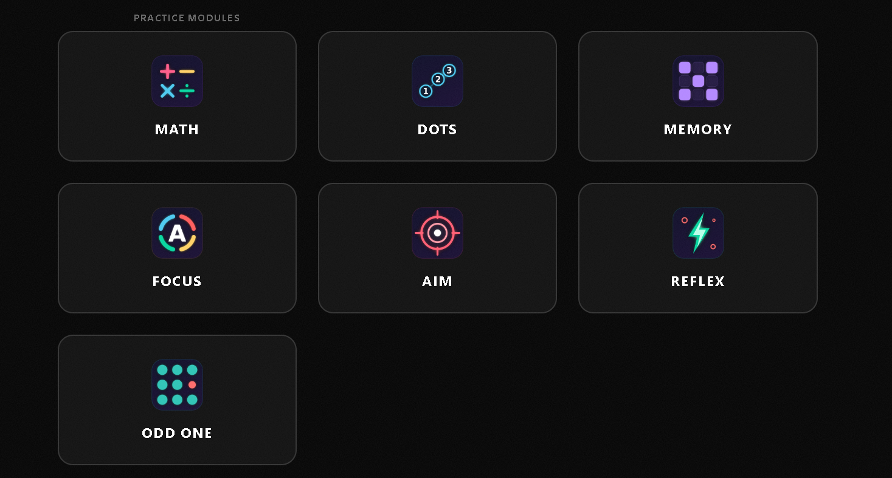
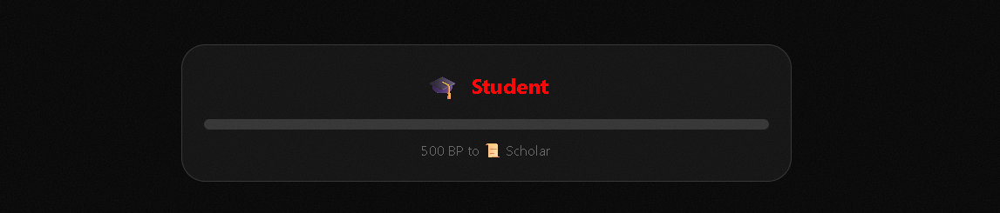

# 🧠 NyxApse

**NyxApse** is a web-based mental training suite designed to sharpen your cognitive reflexes, mathematical speed, focus, and memory. Build your **Brain Power**, climb the ranks, and master your mental discipline.

**[🚀 Play NyxApse Now](https://shadowed-monarch.github.io/NyxApse/)**


---

## 🎮 Game Modes
* **🔢 Math:** Solve falling equations before they hit the bottom.
* **⚪ Dots:** Tap numbered dots in order to train focus and visual coordination.
* **🧠 Memory Matrix:** Memorize glowing blocks, then recall them. The grid grows with your level.
* **🎯 Focus:** Type the *color* of the word, not the word itself. Trains attention and impulse control.
* **🔴 Aim:** Pop the bubbles falling two at a time before time runs out. The goal grows from 15 to 20 pops by level 100, and bubbles get faster each level. Bubbles are smaller on phones.
* **⚡ Reflex:** Dodge the falling bubbles and survive until the timer ends.
* **🔷 Odd One Out:** Tap the one shape that differs in color, size or rotation. The grid grows with your level.
- **🔲 N-Back:** A square lights up on a 3x3 grid. Tap SAME when it is where it was N steps ago. N grows from 1 to 5 as you level up and the pace gets faster. 3 mistakes fail the level. A classic working-memory trainer.
  

## 🏆 Ranking System
Eight ranks, with a rank-up celebration and "BP to next rank" on the home screen:
* 🎓 **Student:** 0 - 499 BP
* 📜 **Scholar:** 500 - 1,499 BP
* 🦉 **Sage:** 1,500 - 2,999 BP
* 💡 **Genius:** 3,000 - 5,999 BP
* ⚡ **Prodigy:** 6,000 - 9,999 BP
* 👑 **Mastermind:** 10,000 - 19,999 BP
* 🏆 **Grandmaster:** 20,000 - 49,999 BP
* 🌌 **Overlord:** 50,000+ BP

## ✨ Features
* **Unlimited Levels:** Each game tracks its own level; speed and difficulty scale up.
* **Two Currencies:** Each win earns Brain Power (level × 5 up to level 30, then slower), which sets your rank and never goes down, plus coins (5 + level, up to 55) that you spend in the shop.
* **Skin Shop:** 32 accent skins bought with 🪙 coins: 20 solid colors (Blue 100 up to Gold 4,000), 5 animated skins (Aurora, Sunset, Ocean, Lava and the **Legendary Rainbow** at 10,000), and 7 you can only earn (Legend for level 100, Ember for a 30-day streak, and one for reaching each of Gold, Platinum, Diamond, Master and Legend on the leaderboard). Tap a skin to preview it before you buy. Buying skins never lowers your rank.
* **Light / Dark / Auto Mode:** Choose it in ⚙️ Settings; it applies to every game.
* **Daily Streak & Calendar:** Win a level each day to keep your streak. Your first win of the day pays bonus coins (streak days × 10, max 70), and a calendar on the home screen shows every day you played.
* **Stats:** Streak, total wins, time trained and level per game on the home screen.
* **Level Select:** Use ◀ ▶ in any game to replay lower levels.
* **Save Tools:** Export, import or reset your save code in ⚙️ Settings → Data.
* **Earnings Ledger (anti-cheat):** every win is written to a chained, signed log with the game, level, time and reward. Your Brain Power, coins and levels must match the log, and only a real finished round can add to them. Edits made in browser DevTools or the console are undone. It's a strong deterrent, not real security, since everything runs on the player's device.
* **Settings (⚙️ on every page):** focus sound (brown, pink or white, with volume), sound effects, vibration, theme (dark, light or auto), a **Minimal** style (flat, sleek and fast: no glow, shadows, grain, blur or color animation, and it keeps your colors), a separate **Black & white** switch, a **Colorblind-friendly** switch (safe colors plus a symbol for each color in Focus, ✓/✕ marks in Memory), and switches for glow, grain, confetti, large text and compact layout.
* **Game Timers:** change the seconds for each game within a safe range. More time is easier, so wins pay a little less; less time pays more.
* **Profile & Menu:** pick a nickname and avatar on first launch, see your stats in your profile, and use the menu on the left of the home screen.
* **Leaderboard (optional):** weekly boards of Brain Power earned, powered by Supabase. Off by default; you join with a nickname and avatar, with no email or account. The server re-checks every win. See `supabase/README.md` to set it up.
* **Divisions and Seasons:** a ladder separate from your BP rank: Bronze 3 → 2 → 1, then Silver, Gold, Platinum, Diamond, Master and Legend (19 steps). You only see your own group (max 30, same division). Each week the **Ascent Zone** (▲) moves up, the **Drop Zone** (▼) moves down and everyone else is **Steady**; the zone sizes shrink as you climb. A season is a calendar month: at its end your final division is saved, coins are paid and everyone drops 2 steps. Your profile shows your best division with a small number for how many seasons you finished there (🥇²). Tap a name on the board to see that player's profile, and report cheaters.
* **Privacy:** no ads, no analytics, no tracking. See `privacy.html`.
* **Sound:** Adjustable-volume brown-noise focus sound, plus win/lose sounds and vibration.
* **Math Variety:** Subtraction unlocks at level 4, multiplication at level 8.
* **Focus Buttons:** Tap color buttons instead of typing.
* **Daily Challenge:** A different game each day. Win it 2 to 4 times for +60 coins.
* **Achievements:** 12 badges for wins, streaks, levels, skins and training time, 25 coins each.
* **Best Times:** Fastest clear is saved per game and level.
* **How-to-Play Popups:** Shown the first time you open a game (reopen with ?).
* **Pause Button:** Pause any running game with ⏸.
* **Confetti:** Celebrates every win and new skin.
* **Fair Timers:** Timers pause when you switch tabs.
* **Installable:** Add to your home screen and play offline (PWA).
* **About Page:** Rules, ranks and tips, linked from the home screen.
* **Local Progress:** Ranks, levels and skins are saved in your browser's `LocalStorage`.
* **Responsive UI:** Works on desktop and mobile (mouse and touch).

## 🔊 Focus Sound
The focus sound (⚙️ Settings → Sound) is **brown noise** by default, and you can switch to pink or white. It keeps playing as you move between pages. Brown noise is a deep, soft rumble, a bit like distant rain or a waterfall. White noise is brighter and hissier, like static.

Which one is better comes down to taste. Research on background noise and focus is mixed, almost all of it used white noise, and no solid study shows brown noise beating white. Quieter is usually better than louder. Phone speakers play deep sounds weakly, so brown noise sounds thinner there, and headphones give the full effect. The sound is only a relaxing background, not a medical tool.

## 📁 Project Structure
```
NyxApse/
├── index.html, about.html, privacy.html
├── math.html, dots.html, memory.html,
│   stroop.html (Focus), aim.html, avoid.html (Reflex), oddout.html, nback.html
├── css/
│   ├── ui.css                      # shared responsive UI
│   ├── shell.css                   # settings, menu, shop, minimal look (loads last)
│   └── <page>.css                  # styles for each page
├── js/
│   ├── theme.js                    # skins, light/dark, saved looks
│   ├── game.js                     # ranks, streaks, ledger, save protection, messages
│   ├── shell.js                    # settings, profile, menu, focus sound, leaderboard screens
│   ├── config.js                   # your Supabase URL and public key (empty by default)
│   ├── leaderboard.js              # optional online leaderboard client
│   └── <page>.js                   # logic for each page
├── supabase/                       # database script + setup guide for the leaderboard
├── .github/workflows/keepalive.yml # keeps a free Supabase project awake
├── android/                        # the Android app (APK / F-Droid)
├── fastlane/                       # store listing: description, icon, screenshots
├── fdroid/                         # the entry you submit to F-Droid
├── tools/set_version.py            # change the version everywhere at once
├── docs/RELEASE.md                 # step-by-step release guide
├── manifest.json, sw.js            # installable / offline support
├── LICENSE                         # MIT
└── logo.png, icon*.png, *.png      # images
```

## 🛠️ Technical Details
* **Frontend:** HTML5, CSS3, JavaScript (ES6+). No frameworks.
* **Data:** `LocalStorage` on your device. No account is needed. An online leaderboard (Supabase) is optional.
* **Shared Theme:** `theme.js` applies the saved mode and skin to every page.
* **Shared Logic:** `game.js` handles ranks, streaks, stats, sounds and save tools. `sw.js` + `manifest.json` make it installable.
* **Deployment:** Hosted via GitHub Pages.

> [!IMPORTANT]
> **Data Note:** Clearing your site data or browser history will reset your Brain Power, levels, and unlocked skins.

## 📱 Android app and F-Droid
The `android/` folder is a small native app that shows the bundled game. See `docs/RELEASE.md` for how to build the APK, publish on F-Droid and change the version.

## 📄 License
MIT, see the `LICENSE` file.

## 👤 Author
Developed and owned by **Shadowed**.
* **GitHub:** [@shadowed-monarch](https://github.com/shadowed-monarch)
